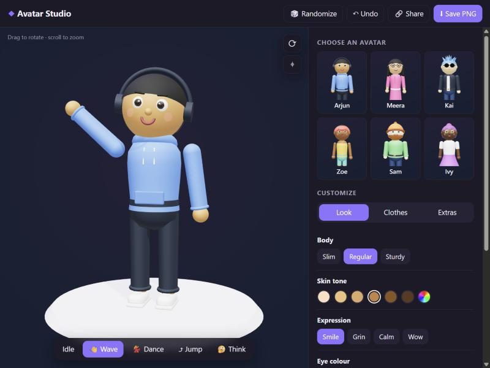

# Avatar Studio 🧍

**Realistic, rigged 3D people you can animate, give expressions, recolour and export, right in the browser.** Pick a person, recolour their outfit, change their facial expression, play one of 13 motion-captured moves, and download them as a GLB ready for Blender, Unity, Unreal or Godot.



**Try it live: https://memoriesrohit.github.io/avatar-studio/**

## What you get

- **8 realistic people:** Sophia, Mia, Priya and Emma; Daniel, Marcus, Arjun and Ryan. They're professionally made, fully rigged characters from the Microsoft Rocketbox library, with detailed faces, skin, hair and clothing (colour, normal and gloss maps for both head and body).
- **Outfits:** each person's own outfit (office formal, smart casual or casual), or put anyone in a **white shirt or white T-shirt with formal trousers**. Pick the trousers in **black or blue**, and recolour the shirt, T-shirt or original outfit with the colour swatches. Recolouring only touches the clothes and keeps the fabric detail.
- **10 facial expressions:** neutral, smile, big laugh, excited, confident, serious, surprised, angry, sad and wink. They're built from the 52 Apple ARKit face shapes each character carries. Characters also blink naturally.
- **13 motion-captured moves:** idle, walk, wave, talk, confident talk, argue, cheer, laugh, drink, clap, think, shrug and phone call. This is professional motion capture recorded for these exact skeletons, with **female performers for the women and male performers for the men**, so no retargeting distorts it. Each move starts with a fitting expression.
- **Eye contact:** during calm moves the character turns their head and **looks you in the eye**, using real eye bones; the eyes make the small quick darts real eyes do, and moves blend smoothly into each other
- **Studio rendering:** lit by a photographed studio environment, with soft shadows, screen-space ambient occlusion and colour-true (Khronos PBR Neutral) tone mapping
- **Face close-up**, auto-rotate, randomize and share links

## Export

| Format | What you get | Use it in |
|---|---|---|
| **GLB** | Skinned character with its skeleton, all 13 moves as animation clips, all face shapes, with your outfit colour and expression | Blender, Unity, Unreal, Godot |
| **glTF** | Same as GLB, as a readable JSON file | Same as GLB |
| **OBJ** | Shape only, standing pose | Almost any 3D app |
| **STL** | Shape only | 3D printing |
| **USDZ** | Model with materials | AR Quick Look on iPhone and iPad |
| **PNG** | Picture of the current view | Anywhere |

**Need FBX?** Browsers can't write FBX. Export a **GLB**, open it in [Blender](https://www.blender.org/) (*File → Import → glTF 2.0*), then *File → Export → FBX*.

## Run it

It's a static site with no build step. Serve the folder with any web server:

```bash
git clone https://github.com/memoriesrohit/avatar-studio
cd avatar-studio
python -m http.server 8000
```

Then open http://localhost:8000. Opening `index.html` directly from disk won't work, because browsers block ES modules and model loading on `file://` URLs.

## How it's made

```
index.html, css/       the page
js/catalog.js          people, outfits, outfit colours, expression recipes
js/scene.js            loads a character, plays moves, blinks, eye contact, expressions, materials, lighting
js/export.js           GLB / glTF / OBJ / STL / USDZ / PNG export
js/main.js             editor panel, export menu, share links
models/*.glb           one rigged character per person (8 to 10 MB each)
models/thumbs/         picker thumbnails (tools/thumbs.py)
assets/                studio lighting environment (HDRI)
tools/rocketbox/       the Blender script that builds models/ from the Rocketbox library
tools/makehuman/       the earlier MakeHuman + CMU mocap pipeline (no longer used for the shipped models)
```

`tools/rocketbox/rb_outfits.py` builds each person (it uses `rb_build.py` for the steps below), then adds the swappable outfit:

- The white shirt, white T-shirt and formal trousers are taken from other Rocketbox characters of the same sex (listed in `DONORS`). Each garment's vertices are moved by how far its bones sit from the person's, then bound to the person's skeleton.
- Garment faces are sorted into top, trousers, shoes and skin by their dominant bone and the texture colour under them. The trousers end in a straight cut at the ankle, and a top from a different character gets a straight hem a few cm over the waistband, pushed just outside the trousers.
- Their textures are neutralised: the tops to white and the trousers to light grey, keeping only soft fold shading, so the app can tint them. Bare arms and hands are tinted to the person's own skin colour (measured on the cheeks), and the neckline is snapped onto the person's neck.

`tools/rocketbox/rb_build.py` does the per-person conversion:

1. Imports the avatar's facial FBX with its native 3ds Max Biped skeleton, converts centimetres to metres, and faces it forward.
2. Renames the skeleton's bones to Mixamo names (`mixamorig:Hips`, …) so tools that expect a Mixamo rig work with the export.
3. Rebuilds the materials: colour, normal map, roughness derived from the specular map, and alpha for hair and lashes. It splits the mesh into face, hands, outfit and hair, so recolouring the outfit never tints skin.
4. Keeps the 52 ARKit face shapes under their standard names (`mouthSmileLeft`, `eyeBlinkRight`, …).
5. Transfers each Rocketbox animation onto the character: every bone takes the source bone's orientation each frame (same skeleton and bone axes), and the hips also take its translation. It then bakes each move as its own clip.
6. Exports a GLB with WebP textures.

### Rebuilding the characters

Download from the [Microsoft Rocketbox repository](https://github.com/microsoft/Microsoft-Rocketbox) into `tools/rocketbox/rocketbox/`:

- for each avatar listed in `tools/rocketbox/build_all.sh` (for example `Professions/Business_Female_04`) and each outfit donor in `DONORS` in `rb_outfits.py` (`Business_Male_06`, `Male_Adult_09`, `Female_Adult_15`, `Female_Adult_17`, `Female_Adult_01`), its `Export/<name>_facial.fbx` and `Textures/` folder, keeping that layout under `rocketbox/<name>/`
- the animation clips listed in `NATIVE_MOVES` in `rb_build.py`, from `Assets/Animations/all_animations_max_motextr_*`, renamed to `rocketbox/anims/<clip>.fbx`

Then, with Blender 4.2 or newer:

```bash
cd tools/rocketbox
BLENDER=blender sh build_all.sh   # people with swappable outfits
cd ..
blender -b -P thumbs.py -- ../models ../models/thumbs sophia mia priya emma daniel marcus arjun ryan
```

To add someone, pick any of the 115 Rocketbox avatars, add a line to `build_all.sh` and an entry to `PEOPLE` in `js/catalog.js`.

## Credits and license

- Code: MIT, by [Rohit Biradar](https://github.com/memoriesrohit)
- Characters and motion capture: [Microsoft Rocketbox Avatar Library](https://github.com/microsoft/Microsoft-Rocketbox), **MIT licence**, © Microsoft Corporation (full notice in [THIRD_PARTY_NOTICES.md](THIRD_PARTY_NOTICES.md)). Research use is asked to cite: Gonzalez-Franco et al., *The Rocketbox Library and the Utility of Freely Available Rigged Avatars*, Frontiers in Virtual Reality (2020), DOI 10.3389/frvir.2020.561558.
- Studio lighting: [Studio Small 09](https://polyhaven.com/a/studio_small_09) HDRI from Poly Haven, **CC0**
- 3D in the browser: [three.js](https://threejs.org/) (MIT)
- The earlier MakeHuman pipeline in `tools/makehuman/` used [MakeHuman](http://www.makehumancommunity.org/) CC0 assets, [MPFB](https://static.makehumancommunity.org/mpfb.html) and the [CMU Graphics Lab Motion Capture Database](http://mocap.cs.cmu.edu/)
